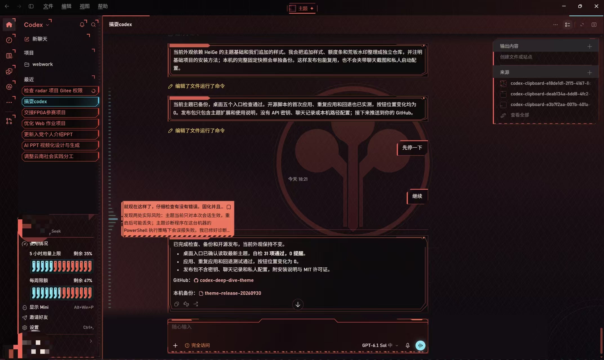

# Codex Deep Dive Theme · 深潜协议

为 Codex 桌面版制作的赛博朋克主题：酒红与近黑背景、珊瑚红切角面板、青色选中状态、工业输入框、额度 RAM 分段条和荒坂风格背景水印。包含完整 CSS 快照，可通过本仓库脚本独立应用。

> **关于 HeiGe 中找不到“深潜协议”**：反馈属实。`deep-dive-protocol` 是本项目开发机添加的自定义主题，不是 HeiGe 上游的内置预设。旧版 README 要求先去 HeiGe 选择它，这是错误的安装前提。当前版本已取消该前提；无需先安装 HeiGe 或寻找同名预设。



以上为用户授权发布的实际效果图，账户区域已打码；图中仍包含部分聊天标题、文字和额度。实际界面取决于 Codex 版本、窗口大小及当前界面状态，不要求另装基础主题。

[查看设计示意图](docs/preview.svg)

## 能做什么

- 对话选项采用红黑切角卡片，选中、悬停和键盘聚焦时青色高亮。
- 对话导航刻度的悬浮预览采用珊瑚红机械面板。
- 底部输入框增加折线顶边、角部细线和三角警戒纹，不移动原生按钮。
- 助手回复框采用红黑信息面板，限制图片与放大按钮宽度，保留图片比例。
- 在原生中文/英文额度菜单可识别的 5 小时与每周“剩余百分比”下显示 14 格 RAM 条。
- 使用嵌入式 SVG 水印，不请求远程图片，不需要驻留后台服务。

这是**外观扩展**，不包含模型路由、API 密钥或模型切换功能。模型路由项目：[codex-multi-model-router](https://github.com/zczczzc431/codex-multi-model-router)。

## 安装与应用

要求：Node.js 22 或更新版本；已运行的 Codex 桌面版；仅绑定本机回环地址的 CDP 调试端口（默认 9341）。

1. 配置当前 Codex 版本可用的本机调试入口：启动参数为 `--remote-debugging-address=127.0.0.1 --remote-debugging-port=9341`。如果 Codex 已经运行但未开启该端口，先保存工作，再手动退出并通过带参数的入口启动。Microsoft Store/MSIX 安装的激活方式与普通 exe 可能不同；也可参考 [HeiGe 的启动说明](https://github.com/HeiGeAi/heige-codex-skin-studio)，但**无需在其中选择“深潜协议”**。本脚本不会替你关闭或重启 Codex。
2. 点击仓库右上方 **Code → Download ZIP**，或[直接下载最新版 ZIP](https://github.com/zczczzc431/codex-deep-dive-theme/archive/refs/heads/main.zip)。**先完整解压**，再进入解压后的 `codex-deep-dive-theme-main` 文件夹；Windows 可直接双击里面的 `Apply Theme.cmd`。不要在压缩包预览中直接运行脚本。

   使用 Git 下载和命令行应用，也可运行：

   ```powershell
   git clone https://github.com/zczczzc431/codex-deep-dive-theme.git
   cd codex-deep-dive-theme
   node scripts/theme.mjs check
   node scripts/theme.mjs status
   node scripts/theme.mjs apply
   ```

3. Windows 可以双击 `Apply Theme.cmd`。返回退出码 `0` 表示本次应用成功；报错时会显示原因。

不需要 `npm install`。自定义端口示例：`node scripts/theme.mjs apply --port=9341`。

脚本不会打开、关闭、重启或重新安装 Codex，也不会移动工作记录、修改 WindowsApps、app.asar 或签名文件。可以从原生界面直接应用；若检测到其他 HeiGe 主题已激活，会拒绝覆盖，请先从原工具关闭该主题。

脚本会排除 Spotlight、头像覆盖层和分离窗口。若有多个主窗口，先从 `http://127.0.0.1:9341/json/list` 确认目标，再使用 `node scripts/theme.mjs apply --target-id=<目标ID>`；不会随意选择第一个窗口。

## 回退、重启与更新

```powershell
node scripts/theme.mjs remove
```

也可双击 `Remove Theme.cmd`。回退仅删除本工具的样式和本工具创建的额度运行时，并还原由本工具设置的主题标记；保留已有的共享主题及额度运行时。`status` 和 `remove` 不依赖主题文件完整性，校验失败时仍可回退。

本扩展使用当前窗口的运行时 CSS 注入。**Codex 重启或更新后需要重新应用**；桌面可为 `Apply Theme.cmd` 创建快捷方式。没有自动后台重注入，也不保证兼容尚未测试的新版本。

2026-10-31 开发机已验证：`codex-cli 0.166.0-alpha.5.1` 对应的桌面环境，原有深潜主题、RAM 运行时及主窗口选择通过检查；独立应用/移除与布局回退另有自动化测试。这不代表所有安装方式及后续版本均已验证。更新后先运行 `status`，再运行 `apply`；入口或 DOM 变化导致报错时请提交 issue。该工具只连接 `app://-/index.html` 的主窗口，不会选择普通浏览器页面。启用调试端口时应仅允许回环访问，不应暴露给局域网或公网。

## 布局与可读性

装饰使用 CSS 背景与 `pointer-events: none` 的伪元素。原生输入、附件、模型按钮的位置不变；应用时会比较侧栏及输入区按钮矩形，变化超过 0.5px 时回退本扩展。回复图片宽度修复可能使回复高度减少，这是让图片完整适配内容框的预期结果。

额度条只读取界面里可识别的剩余百分比，不直接请求账户 API；无法识别的菜单条目不会生成额度条。它不是独立的用量统计服务。

## 文件与开发

- `theme/deep-dive.css`：完整主题快照，包含生成的基础规则、自定义 HUD 样式、内嵌背景和水印；与开发机确认版逐字一致。
- `theme/arasaka-watermark.svg`：水印的可编辑矢量源。
- `runtime/quota-ram.js`：额度条的 DOM 监听逻辑。
- `scripts/theme.mjs`：检查、状态、应用和回退，无第三方运行依赖。

修改 CSS 后先审核改动，再更新校验值：

```powershell
node -e "const fs=require('fs'),c=require('crypto');fs.writeFileSync('theme/deep-dive.css.sha256',c.createHash('sha256').update(fs.readFileSync('theme/deep-dive.css')).digest('hex'))"
node scripts/theme.mjs check
```

SVG 源修改后需同步 CSS 内嵌版本。发布包包含完整 CSS 快照及其内嵌背景，但不包含 HeiGe Studio 程序、其全部预设、开发机日志、账户配置或 `.lnk` 快捷方式。无需从上游另行下载不存在的同名主题。

运行 `node --test` 验证重复应用、共享运行时保护、安装失败和布局变化回退。GitHub Actions 在 Windows/Linux 的 Node.js 22/24 上执行测试与分发文件校验；这些检查不替代新版 Codex 的实际界面验收。

### 截图隐私

首页使用用户指定的账户区域打码截图。早期未打码截图已从当前版本撤下，但普通删除不会清除 Git 历史中的图片；发布自己的截图前，请检查昵称、额度、聊天标题、路径和对话内容。

## License / Credits

本仓库代码按 MIT 许可证发布。基础 CSS 生成器与部分规则源自 [HeiGeAi/heige-codex-skin-studio](https://github.com/HeiGeAi/heige-codex-skin-studio)（MIT）；本仓库包含经自定义修改的生成结果，保留其版权声明，见 [THIRD_PARTY_NOTICES.md](THIRD_PARTY_NOTICES.md)。深潜协议的配色、HUD 调整与集成为本项目定制，不是上游自带预设。此前“基础主题来自上游，未在本仓库分发”的表述不准确，现予更正。

Cyberpunk 2077、Arasaka / 荒坂及相关名称属于其各自权利人；本项目是非官方风格扩展，与 OpenAI、CD PROJEKT RED 无关联。MIT 不授予第三方商标或游戏美术的权利。水印为参考风格绘制的 SVG；完整 CSS 另含背景图片，代码许可证不等于这些视觉素材的再分发授权。
